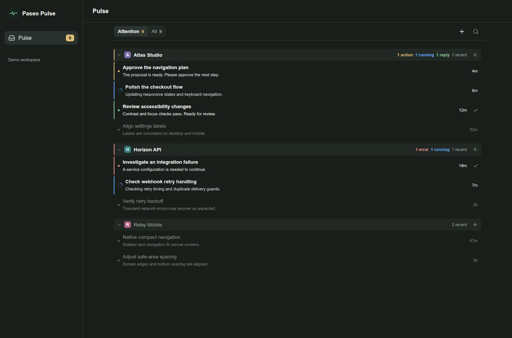
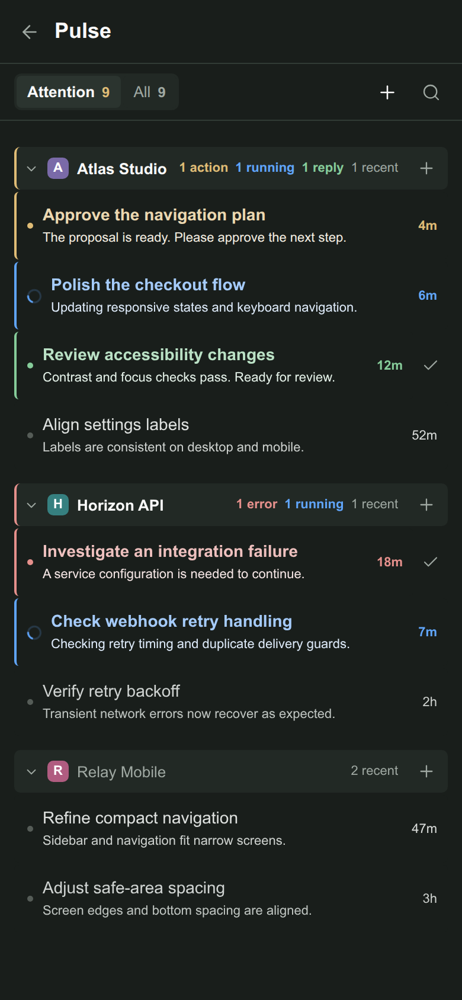

# Paseo Pulse

A project-grouped attention inbox for your Paseo sessions. Find the agents that need you, then open their native session with one click.



## Install

Requires **Paseo 0.15.0+**, **Node.js 24+**, and plugins enabled on the target daemon.

From the public Git repository:

```sh
paseo plugin add git:js2me/paseo-pulse
```

Or from npm:

```sh
paseo plugin add npm:paseo-pulse
```

For a local checkout:

```sh
npm ci --ignore-scripts
paseo plugin install "$PWD"
```

The Git/npm commands become available when those sources are published. Registry submission is prepared separately; there is no approved catalog ID yet.

Open **Pulse** in the sidebar or **Open Pulse** in the Command Center. The native composer also has an **Open in Pulse** shortcut back to this list.

## What stays in Attention

- Running or starting agents, permission requests, unread errors and new replies.
- Conversations with messages in the last **four hours**, including read conversations.
- Sessions opened from this plugin at least **three times in seven days**. Repeated clicks within a minute count once.

Read sessions are gray. Running work stays blue, new replies green, permission requests yellow and errors red. Marking a reply **OK** clears that exact reply's attention marker; a later reply is highlighted again. The sidebar badge uses the same rules as the page.

**All** starts with six recent sessions per project. **More** reveals the rest. Search covers projects, workspaces, titles, providers and paths. The project **+** creates and opens an unnamed session immediately, reusing the model, mode, thinking level and feature settings of the last session used in that project. The global **+** uses the last session overall and its folder. Recency follows user prompts and session creation, not background status changes; search and attention filters do not affect the choice. Settings are refreshed before creation. If a project has no prior session, the most recent global session supplies the settings. With no history, an available host profile or provider default is used. No selection dialog or title is required.

<details>
<summary>Compact view</summary>



</details>

Screenshots render the actual plugin components with sample data in an isolated web harness. The compact image is not a physical-device test. Regenerate them with `npm run test:media`.

## Languages

English, Russian, French and Traditional Chinese follow the app's language setting. English is the fallback. Chinese variants, including Paseo's current `zh-CN` option, use Traditional characters. Language changes preserve search and expanded groups. User session names and conversation content are not translated.

## Data and runtime

The list uses the existing Paseo host connection and reads saved provider transcripts locally for short previews. Opening or refreshing the list does not start agents. OpenCode database reads are read-only. Project icons use Paseo's existing project metadata and local icon files. No external services or additional runtime dependency installation are used.

OK marks are stored in host settings. Visit history is saved at `$PASEO_HOME/plugin-data/paseo-session-inbox/session-visits.json` (Paseo home defaults to `~/.paseo`). Native views outside this plugin are not exposed by the SDK and do not contribute to the frequency rule. Existing prototype drafts, queues and attachments are left on disk and are no longer processed.

The stable runtime ID is **paseo-session-inbox**; the public package and repository are **paseo-pulse**. This keeps existing settings and data when the plugin is updated. The interface entry is **Пульс** in Russian and **Pulse** in other app languages.

See [OVERVIEW.md](OVERVIEW.md) for listing copy and [publishing preparation](.github/PUBLISHING.md) for release steps.

## Code structure

The UI follows MVVM with MobX **6.16.1** and **mobx-view-model-react 11.0.1**.
React bindings create and dispose view models through `useCreateViewModel`;
`observer` subscribes views to their observable state. `mobx-view-model` supplies
the view-model lifecycle. Timers and acknowledgement reactions are disposed
when their view model unmounts.

| Directory | Responsibility |
| --- | --- |
| `client/app` | Paseo contribution registration and native composer shortcuts |
| `client/views` | React Native screen, toolbar, groups, rows, sidebar and logos |
| `client/view-models` | Observable UI state, computed presentation and commands |
| `client/bindings` | SDK hooks, React Query and view-model payload adapters |
| `client/data` | Live directory, caching and transcript-derived activity |
| `client/services` | Session creation and settings inheritance |
| `client/i18n` | Translations and formatting |
| `client/lib`, `client/generated` | Shared library facade and bundled MVVM runtime |
| `shared/sessions`, `shared/projects` | Domain rules, types and RPC contracts |
| `server/sessions`, `server/projects` | Host transcript, visit and icon access |

The shared MVVM bundle keeps all models on one MobX instance and uses Paseo’s
React instance. It ships with source maps and third-party notices; installation
does not download runtime libraries. Rebuild it with `npm run build:runtime`.

## Development

```sh
npm ci --ignore-scripts
npm run typecheck
npm test
npm run release:check
paseo plugin reload paseo-session-inbox
```

The runtime entries are `index.client.tsx` and `index.server.ts`. Client UI lives in `client/`, local transcript/index work in `server/`, and RPC schemas and attention rules in `shared/`. Development and CI use the committed `package-lock.json`.

## License

Original code: [MIT](LICENSE). Project icon discovery adapted from Paseo retains Apache-2.0 terms; see [third-party notices](THIRD_PARTY_LICENSES.md).
